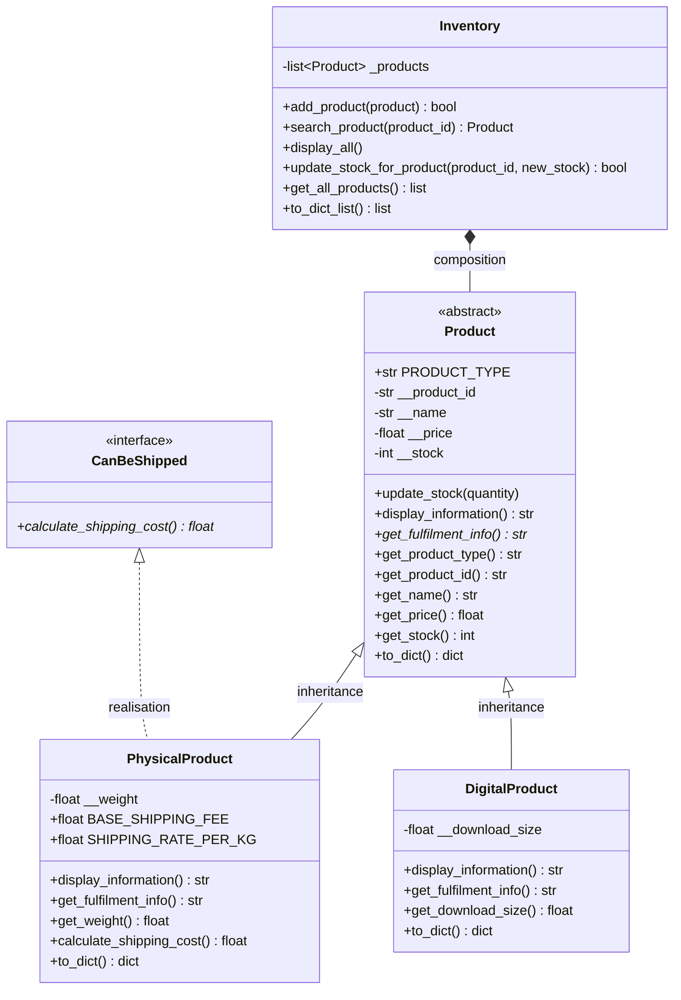

# UML Class Diagrams - Lab 7 (Inheritance, Overriding and Abstraction)

## Overview

This document contains the UML class diagrams for the Inventory Management
System after the Lab 7 extension. The system now has:

- `Product` - an **abstract** base class holding the data and behaviour common
  to every product.
- `PhysicalProduct` - a subclass that adds a weight and can be shipped.
- `DigitalProduct` - a subclass that adds a download size.
- `CanBeShipped` - an **interface-style abstract base class** (a capability
  contract, not a parent class).
- `Inventory` - manages a collection of `Product` objects.

File handling and the menu live outside the model classes, following the
Single Responsibility Principle.

---

## Class Diagram

```
                        ┌───────────────────────────────────────┐
                        │             <<abstract>>              │
                        │                Product                │
                        ├───────────────────────────────────────┤
                        │ - __product_id : str                  │
                        │ - __name : str                        │
                        │ - __price : float                     │
                        │ - __stock : int                       │
                        ├───────────────────────────────────────┤
                        │ + __init__(product_id, name, price,   │
                        │            stock)                     │
                        │ + update_stock(quantity)              │
                        │ + display_information() : str         │
                        │ + get_fulfilment_info() : str         │  <<abstract>>
                        │ + get_product_type() : str            │
                        │ + get_product_id() : str              │
                        │ + get_name() : str                    │
                        │ + get_price() : float                 │
                        │ + get_stock() : int                   │
                        │ + to_dict() : dict                    │
                        │ + __str__() : str                     │
                        └───────────────────▲───────────────────┘
                                            │
                       ─────────────────────┼─────────────────────
                        solid line, hollow triangle = inheritance
                       ─────────────────────┼─────────────────────
                  ┌─────────────────────────┴─────────────────────────┐
                  │                                                   │
┌─────────────────┴──────────────────┐             ┌──────────────────┴─────────────────┐
│          PhysicalProduct           │             │          DigitalProduct            │
├────────────────────────────────────┤             ├────────────────────────────────────┤
│ - __weight : float                 │             │ - __download_size : float          │
├────────────────────────────────────┤             ├────────────────────────────────────┤
│ + __init__(product_id, name,       │             │ + __init__(product_id, name,       │
│            price, stock, weight)   │             │            price, stock,           │
│ + display_information() : str      │             │            download_size)          │
│ + get_fulfilment_info() : str      │             │ + display_information() : str      │
│ + get_weight() : float             │             │ + get_fulfilment_info() : str      │
│ + calculate_shipping_cost() : float│             │ + get_download_size() : float      │
│ + to_dict() : dict                 │             │ + to_dict() : dict                 │
└─────────────────▲──────────────────┘             └────────────────────────────────────┘
                  ┆
                  ┆ dashed line, hollow triangle = interface realisation
                  ┆
┌─────────────────┴──────────────────┐
│           <<interface>>            │
│            CanBeShipped            │
├────────────────────────────────────┤
│ + calculate_shipping_cost() : float│  <<abstract>>
└────────────────────────────────────┘

┌────────────────────────────────────┐
│             Inventory              │
├────────────────────────────────────┤
│ - _products : list[Product]        │
├────────────────────────────────────┤
│ + __init__()                       │
│ + add_product(product) : bool      │
│ + search_product(product_id)       │
│ + display_all()                    │
│ + update_stock_for_product(        │
│       product_id, new_stock) : bool│
│ + get_all_products() : list        │
│ + to_dict_list() : list[dict]      │
└─────────────────┬──────────────────┘
                  │ ◆─────── 0..*  (composition)
                  ▼
              Product
```

### Same diagram as Mermaid



> **Notation:** a solid line with a hollow triangle points from the subclass to
> the parent (generalisation/inheritance). A dashed line with a hollow triangle
> points from the implementing class to the interface (realisation).
> `<<abstract>>` marks an abstract class; `*` marks an abstract method.

---

## Class 1: `Product` (abstract)

### Summary

Holds everything common to every product: ID, name, price, stock, stock
updating, the common part of the display, and JSON serialisation. It cannot be
instantiated because `get_fulfilment_info()` is abstract - every product must
say how it is delivered.

### Attributes (private - encapsulation)

| Attribute | Type | Description |
|-----------|------|-------------|
| `__product_id` | `str` | Unique product identifier |
| `__name` | `str` | Product name |
| `__price` | `float` | Product price |
| `__stock` | `int` | Current stock quantity |
| `PRODUCT_TYPE` | `str` | Class constant overridden by subclasses (`None` here) |

### Methods

| Method | Abstract? | Description |
|--------|-----------|-------------|
| `__init__(product_id, name, price, stock)` | no | Stores the common attributes; accepts positional arguments or a single dictionary |
| `update_stock(quantity)` | no | Sets the stock; rejects negative values |
| `display_information()` | no | Prints the common product line |
| `get_fulfilment_info()` | **yes** | Returns how the product is delivered |
| `get_product_type()` | no | Returns the `PRODUCT_TYPE` identifier |
| `get_product_id()` / `get_name()` / `get_price()` / `get_stock()` | no | Encapsulated getters |
| `to_dict()` | no | Returns the JSON-ready dictionary (includes `type`) |
| `__str__()` | no | Readable representation |

### Why abstract?

A generic product would be neither physical nor digital, which the system does
not allow. Trying to create one gives:

```
TypeError: Can't instantiate abstract class Product without an implementation
for abstract method 'get_fulfilment_info'
```

---

## Class 2: `PhysicalProduct`

**Inherits from:** `Product` (solid line, hollow triangle)
**Realises:** `CanBeShipped` (dashed line, hollow triangle)

| Member | Description |
|--------|-------------|
| `__weight` | Weight in kilograms |
| `display_information()` | Calls `super().display_information()`, then prints weight, fulfilment and shipping cost |
| `get_fulfilment_info()` | `"Requires physical shipping and handling."` |
| `get_weight()` | Returns the weight |
| `calculate_shipping_cost()` | `5.00 + 2.00 × weight`, rounded to cents |
| `to_dict()` | Calls `super().to_dict()`, then adds `weight` |

---

## Class 3: `DigitalProduct`

**Inherits from:** `Product` (solid line, hollow triangle)
**Does not implement** `CanBeShipped`.

| Member | Description |
|--------|-------------|
| `__download_size` | Download size in megabytes |
| `display_information()` | Calls `super().display_information()`, then prints download size and fulfilment |
| `get_fulfilment_info()` | `"Delivered digitally via download link."` |
| `get_download_size()` | Returns the download size |
| `to_dict()` | Calls `super().to_dict()`, then adds `download_size` |

---

## Class 4: `CanBeShipped` (interface)

**Realised by:** `PhysicalProduct`

A pure contract with one abstract method, `calculate_shipping_cost()`. It has
no attributes and no implementation, so it can be "signed" by any object that
can be shipped, even one that is not a product. It is deliberately **not** a
parent of `PhysicalProduct`: a guitar is not "a shipped", it *must be able to*
be shipped.

---

## Class 5: `Inventory`

Manages a collection of `Product` objects and knows nothing about weights,
download sizes or shipping. It only calls methods that every product promises
to provide, so new product types need no change here.

| Method | Description |
|--------|-------------|
| `add_product(product)` | Adds a `Product` (or dict, rebuilt by the factory) after a duplicate-ID check |
| `search_product(product_id)` | Finds a product by ID |
| `display_all()` | Asks each product to display itself (polymorphism) |
| `update_stock_for_product(product_id, new_stock)` | Finds a product and delegates to `update_stock()` |
| `get_all_products()` | Returns a copy of the product list |
| `to_dict_list()` | Returns the collection as JSON-ready dicts |

---

## Module Structure

```
┌─────────────────────┐
│      product.py     │  Product (abstract)
└──────────┬──────────┘
           │
     ┌─────┴───────────────────┐
     ▼                         ▼
┌──────────────────┐   ┌──────────────────┐
│ physical_product │   │ digital_product  │
│ PhysicalProduct  │   │ DigitalProduct   │
└────────┬─────────┘   └────────┬─────────┘
         │ implements           │
         ▼                      │
┌──────────────────┐            │
│  can_be_shipped  │            │
│   CanBeShipped   │            │
└──────────────────┘            │
                                │
     ┌──────────────────────────┘
     ▼
┌──────────────────┐     ┌──────────────────┐
│ product_factory  │────►│    inventory.py  │
│ create_product() │     │     Inventory    │
└──────────────────┘     └────────┬─────────┘
                                  │
                     ┌────────────┴────────────┐
                     ▼                         ▼
              ┌──────────────┐          ┌──────────────┐
              │ functions.py │          │    app.py    │
              │   File I/O   │          │  Menu / CLI  │
              └──────────────┘          └──────────────┘
                     │
                     ▼
              inventory.json
```

| Module | Responsibility |
|--------|----------------|
| `product.py` | Abstract base: common product data and behaviour |
| `physical_product.py` | Physical products: weight, shipping cost |
| `digital_product.py` | Digital products: download size |
| `can_be_shipped.py` | Shipping capability contract |
| `product_factory.py` | Rebuilds the right subclass from stored data |
| `inventory.py` | Stores, adds, searches and displays products |
| `functions.py` | Loads and saves `inventory.json`; input helpers |
| `app.py` | Displays the menu, gets user input, calls Inventory methods |

---

## Relationships

| Relationship | Notation | Where |
|--------------|----------|-------|
| Inheritance | solid line + hollow triangle | `PhysicalProduct` and `DigitalProduct` → `Product` |
| Interface realisation | dashed line + hollow triangle | `PhysicalProduct` → `CanBeShipped` |
| Composition | filled diamond | `Inventory` ◆—— `Product` (0..*) |
| Dependency | dashed arrow | `Inventory` → `product_factory`, `app.py` → model classes, `functions.py` → factory |

- `PhysicalProduct` uses **single class inheritance** (`Product`) plus **one
  interface** (`CanBeShipped`). `DigitalProduct` only inherits `Product`.
- The `Inventory` stores objects through the abstract `Product` type, which is
  what allows both subclasses to be handled by the same code.

---

## Design Principles Applied

### Open/Closed Principle (OCP)

`Product` is closed for modification and open for extension. Adding a new
product type means adding a subclass, a `PRODUCT_CLASSES` entry in
`product_factory.py`, and an input prompt - the abstract base, `Inventory`,
`functions.py` and the existing product classes stay untouched.

### Single Responsibility Principle (SRP)

- `Product` - common product data/state.
- `PhysicalProduct` / `DigitalProduct` - their own type-specific data.
- `CanBeShipped` - only the shipping contract.
- `Inventory` - only the collection.
- `product_factory` - only object construction from stored data.
- `functions.py` - only file I/O, prompts and display helpers.
- `app.py` - only the menu and user flow.

### Encapsulation

All attributes use the `__` prefix and are only reachable through public
methods. Subclasses never touch the parent's private fields; they use getters
and `super()`.

### Reuse over duplication

Both subclasses call `super().__init__()`, `super().display_information()` and
`super().to_dict()`, so the common product fields are defined once.

---

## Usage Flow Example

```python
from inventory import Inventory
from physical_product import PhysicalProduct
from digital_product import DigitalProduct
import functions as fn

inventory = Inventory()
inventory.add_product(PhysicalProduct("P010", "Guitar", 899.00, 3, 4.5))
inventory.add_product(DigitalProduct("P011", "Photo Editor", 49.90, 999, 1200))

inventory.display_all()

guitar = inventory.search_product("P010")
print(guitar.get_fulfilment_info())        # physical shipping message
print(guitar.calculate_shipping_cost())    # 14.0

editor = inventory.search_product("P011")
print(editor.get_fulfilment_info())        # digital delivery message

fn.save_inventory(inventory)               # writes type + extra fields
```

---

## Lab 7 Requirement Checklist

| Requirement | Location |
|-------------|----------|
| `PhysicalProduct` inherits `Product` and reuses `super().__init__()` | `physical_product.py` |
| `weight` attribute and overridden `display_information()` | `physical_product.py` |
| `DigitalProduct` inherits `Product` and reuses `super().__init__()` | `digital_product.py` |
| `download_size` attribute and overridden `display_information()` | `digital_product.py` |
| Both overrides call `super().display_information()` | `physical_product.py`, `digital_product.py` |
| `Product` inherits `ABC` and declares `@abstractmethod get_fulfilment_info()` | `product.py` |
| Both subclasses implement `get_fulfilment_info()` | both product modules |
| `Product` cannot be instantiated | verified by `test_products.py` |
| `CanBeShipped` interface with `calculate_shipping_cost()` | `can_be_shipped.py` |
| `PhysicalProduct` implements the interface, `DigitalProduct` does not | `physical_product.py` |
| Single class inheritance + interface only | `PhysicalProduct(Product, CanBeShipped)` |
| System supports both types in every menu option | `app.py`, `inventory.py` |
| JSON stores `type` and the extra attributes | `product.to_dict()`, `inventory.json` |
| Loading rebuilds the correct subclass | `product_factory.py` |
