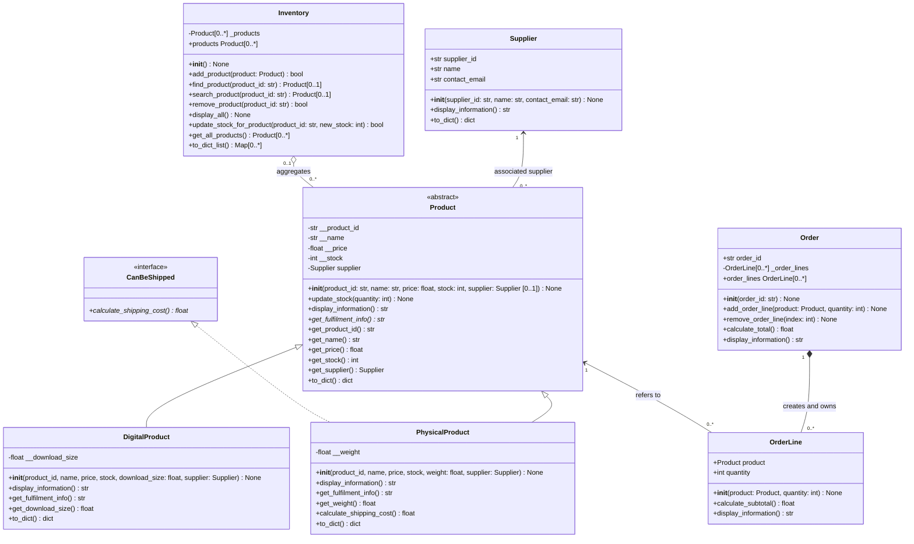

# Inventory System UML

The diagram includes the product hierarchy from Lab 7 and the supplier,
inventory, and order relationships introduced in Lab 8. The multiplicities
show how many objects may participate at each end of a relationship.

## Reading the relationships

- **Inheritance:** a physical or digital product can be used wherever a
  `Product` is expected. Each subclass supplies its own fulfilment behavior.
- **Association:** each product refers to one independently created supplier.
  The supplier can be associated with multiple products and does not belong to
  any one of them.
- **Aggregation:** an inventory keeps references to products, but products
  can exist before they are added and after they are removed. A product can be
  moved by removing it from one inventory and adding the same object to
  another.
- **Composition:** an order creates its own order lines. A line belongs to its
  order; callers add products and quantities rather than supplying
  preconstructed lines.
- **Order-line association:** each line refers to one product. The product
  remains independent and may be present in an inventory or another order.
- **Interface realization:** only `PhysicalProduct` implements
  `CanBeShipped`; a digital product has no shipping behavior.

The solid hollow-triangle arrows indicate inheritance. The dashed
hollow-triangle arrow indicates interface realization. The hollow diamond
marks aggregation, and the filled diamond marks composition. Python type
hints describe these relationships for readers and development tools; they
are not runtime enforcement by themselves. Constructors keep a compatibility
default for records created before supplier data was added; new products
created through the menu receive an explicit `Supplier`.

The diagram reflects the model's intended lifecycle: remove a product from
one inventory before transferring it to another. As with other Python
references, the language itself does not prevent callers from holding extra
references to objects.

## Relationship and multiplicity check

| Relationship | Whole / source | Part / target | Multiplicity |
|---|---|---|---|
| Association | `Supplier` | `Product` | A supplier may serve `0..*` products; each product has `1` supplier. |
| Aggregation | `Inventory` | `Product` | An inventory holds `0..*` products; a product belongs to `0..1` inventory at a time. |
| Composition | `Order` | `OrderLine` | An order owns `0..*` lines; every line belongs to exactly `1` order. |
| Association | `Product` | `OrderLine` | Each line refers to `1` product; a product may be referenced by `0..*` lines. |
| Inheritance | `Product` | `PhysicalProduct`, `DigitalProduct` | Each concrete product is a `Product`. |
